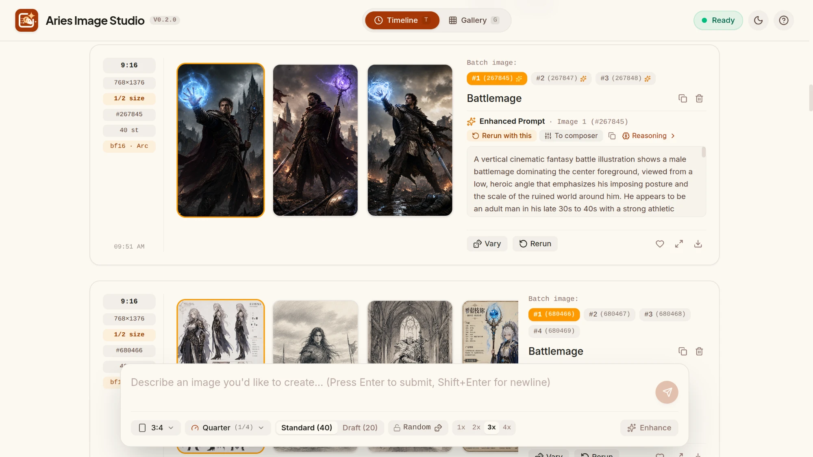
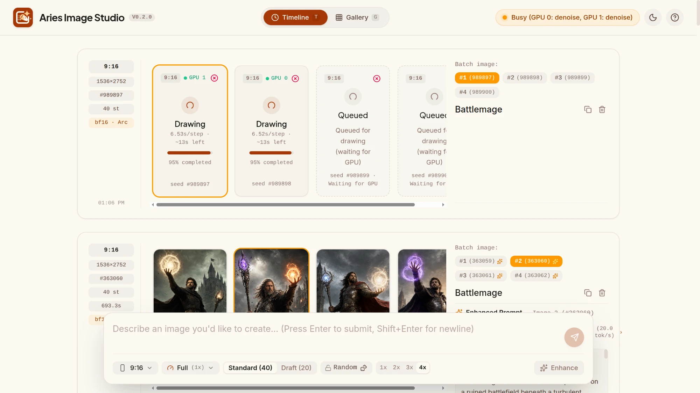

# Aries Image Studio

Type a prompt, get pictures. A quiet, image-first web app for generating images with
[Qwen-Image-2.1](https://huggingface.co/Qwen/Qwen-Image-2.1) on a home server with
two Intel Arc Pro B60 GPUs. Single user, LAN only.

**Version 0.5.0.** A Rust Studio server owns jobs, history and images, and a thin
agent on the GPU host runs the pipeline. It works end to end on the hardware it was
built for; see [Limitations](#limitations) before deploying it anywhere else.
Release notes: [0.5.0](docs/releases/v0.5.0.md) · [0.4.0](docs/releases/v0.4.0.md) · [0.3.1](docs/releases/v0.3.1.md) · [0.3.0](docs/releases/v0.3.0.md) · [0.2.1](docs/releases/v0.2.1.md) ·
[0.2.0](docs/releases/v0.2.0.md).





## Features

- **Timeline**: one turn per send, its images in a carousel in send order, with live
  per-stage progress (enhancing, reading prompt, drawing, finishing), cancel and retry.
- **Composer**: folds to a one-line pill until opened. 7 aspect ratios at ~2K, ½ and ¼
  size presets, 1–4 images, Draft / Standard / High, optional **prompt enhancement**
  with the official Qwen-Image-2.1-PE-T2I rewriter (its reasoning is kept and viewable;
  bf16 or a torchao int4 copy), or optionally a cloud model (Claude Sonnet 5.5, Gemini
  3.5 Flash-Lite) when Studio has an API key: seconds instead of minutes, no card used.
  **Advanced**: custom steps, fixed seed, VAE tiling, and
  rows of different settings sent together for side-by-side comparison.
- **Reference images**: attach up to 4 images (pick, drop, paste, or "Use as reference" on
  any result) and refer to them as "image 1", "image 2" in the prompt to edit or combine
  them. Each reference is VAE-encoded once and stored, so later generations reuse it.
  Enhance works with references too when the image-aware Qwen-Image-2.1-PE-I2I enhancer is
  installed: it reads the images and writes a precise edit prompt.
- **Gallery and viewer**: favorites, search and filters over the whole history, zoom to
  actual pixels with pan and a navigator, Rerun / Vary into the composer, download. Every
  page has its own URL, and long lists load as they scroll.
- **Status page**: each GPU's state, current stage and VRAM; queue depth per stage;
  host RAM.
- **Crash-tolerant backend**: each pipeline stage runs in its own process on one card,
  with intermediate results on disk. A GPU fault costs one stage, which is retried
  once; a card that wedges is taken out of rotation while the other keeps working.
- Prometheus metrics at `/metrics`.

## How it works

```
Browser (web/) ──HTTP──▶ Studio (studio/, Rust)                       always on, no GPU
  timeline, gallery        • web app + /api, SQLite job state, image store
                           • scheduler: which stage runs on which card
                           • gRPC gateway ◀── agents dial in
                                   ▲
                                   │ gRPC + artifact HTTP
                           Agent (backend/aries_agent)                 on the GPU host
                             • declares cards, models, live memory (/metrics)
                             • spawns ▼ one stage worker per card
                           Stage worker (backend/aries_worker)         one process each
                             enhance │ encode │ denoise │ decode — one model, one card
```

A job moves through `enhance` (optional) → `encode` → `denoise` → `decode`. Each stage
loads one model on one card in a fresh process, and the process exits when idle: on
this stack that is the only reliable way to give all memory back. Studio gives a free
card to the stage whose work has waited longest, so a backlog runs two denoises in
parallel. Intermediate results (`.safetensors`) travel through Studio over HTTP, so a
failed stage is retried from its inputs. Details:
[docs/ARCHITECTURE_V3.md](docs/ARCHITECTURE_V3.md).

## Requirements

- GPU host: Linux with the `xe` driver and Level Zero runtime; tested on Ubuntu 26.04
  with 2× Intel Arc Pro B60 (24 GB). An untiled 2048² decode needs a 24 GB card to
  itself.
- Docker with Compose, on the GPU host and on the Studio host (they can be the same
  machine).
- ~50 GB of model weights on local disk (nothing downloads at runtime).

Host setup, dependency order and every failure mode seen so far:
[docs/HARDWARE.md](docs/HARDWARE.md).

## Quick start

Full instructions, including one-machine setups, building from source and
troubleshooting: **[docs/BUILD_AND_RUN.md](docs/BUILD_AND_RUN.md)**.

```bash
# GPU host: weights
hf download Qwen/Qwen-Image-2.1        --local-dir /srv/models/qwen-image-2.1
hf download Qwen/Qwen-Image-2.1-PE-T2I --local-dir /srv/models/qwen-image-2.1-pe-t2i

# Studio host
cd deploy/studio
cp .env.example .env      # ARIES_AGENT_TOKEN (openssl rand -hex 32), ARIES_ARTIFACT_BASE_URL
sudo install -d -o 1000 -g 1000 /var/lib/aries-image-studio
docker compose up -d --build

# GPU host
cd deploy/aries
cp .env.example .env      # same token, ARIES_BACKEND_GRPC_URL, ARIES_METRICS_URL
make build up
```

Open `http://<studio-host>:8080`.

## Configuration

Both sides read environment variables, set through each `deploy/*/.env`. The
essentials are the shared `ARIES_AGENT_TOKEN` and three addresses: Studio's gRPC port
for the agent, Studio's HTTP base for artifact transfer, and the agent's `/metrics` for
Studio. Every variable is listed in
[docs/BUILD_AND_RUN.md §10](docs/BUILD_AND_RUN.md#10-configuration-reference).

## Development

```bash
cd studio && cargo test                              # Rust: API, scheduler, contract tests
cd backend && pip install -e ".[dev]" && pytest      # mocks torch/diffusers; no GPU needed
cd web && npm ci && npm run build && npm run lint
VITE_BACKEND_URL=http://<studio-host>:8080 npm run dev   # hot reload on :5173
```

Running Studio and the agent from source: [docs/BUILD_AND_RUN.md §9](docs/BUILD_AND_RUN.md#9-build-from-source-development).

## Repository layout

```
studio/          Rust Studio server: API, scheduler, SQLite, image store, gRPC gateway
backend/         Python: aries_agent (GPU agent) and aries_worker (stage workers)
proto/           gRPC protocol, artifact and metric contracts shared by both sides
web/             React + TypeScript + Tailwind single-page app
deploy/studio/   Docker Compose for Studio
deploy/aries/    Docker Compose + Makefile (and a systemd unit) for the agent
docs/            Specs, architecture, hardware notes, build and run guide
mockups/         UI mockups (visual reference)
reference/       Batch scripts that validated the pipeline on the hardware
```

| Doc | Covers |
|---|---|
| [docs/BUILD_AND_RUN.md](docs/BUILD_AND_RUN.md) | Building, deploying, configuring and troubleshooting |
| [docs/SPEC.md](docs/SPEC.md) | Product, UX, data model |
| [docs/SPEC_UI.md](docs/SPEC_UI.md) | UI behavior: states, interactions, keyboard, accessibility |
| [docs/ARCHITECTURE_V3.md](docs/ARCHITECTURE_V3.md) | Studio, agents, protocol, scheduling, failures, API |
| [docs/ARCHITECTURE.md](docs/ARCHITECTURE.md) | The 0.2 manager design (superseded) |
| [docs/HARDWARE.md](docs/HARDWARE.md) | Measurements, setup and failure modes on Intel Arc |
| [docs/OPTIMIZATIONS.md](docs/OPTIMIZATIONS.md) | Memory and performance work, with measurements |
| [docs/REFERENCE_IMAGES.md](docs/REFERENCE_IMAGES.md) | Reference images: design and measurements |
| [docs/ENHANCER_I2I.md](docs/ENHANCER_I2I.md) | The image-aware prompt enhancer (PE-I2I) |
| [CHANGELOG.md](CHANGELOG.md) | Every change, by release |
| [docs/releases/](docs/releases/) | Release notes |

## Limitations

- **No user authentication.** Anyone who can reach Studio's port can use it; keep it on
  a trusted network. Agents authenticate with a shared token.
- **Cloud enhancers send data out.** Off by default; switched on, the prompt and any
  reference images of a job that picks one go to that provider, under its terms.
- Built and tested only on Intel Arc (XPU). Other accelerators would need changes in
  the stage workers.

## Roadmap

- Prometheus alert rules and a Grafana dashboard.
- Wake-on-submit and lending cards to other GPU workloads.
- Fast mode and live preview (docs/SPEC.md §8).

## License

MIT — see [LICENSE](LICENSE). The Qwen-Image model weights are under their own
license; check it before any non-personal use.
