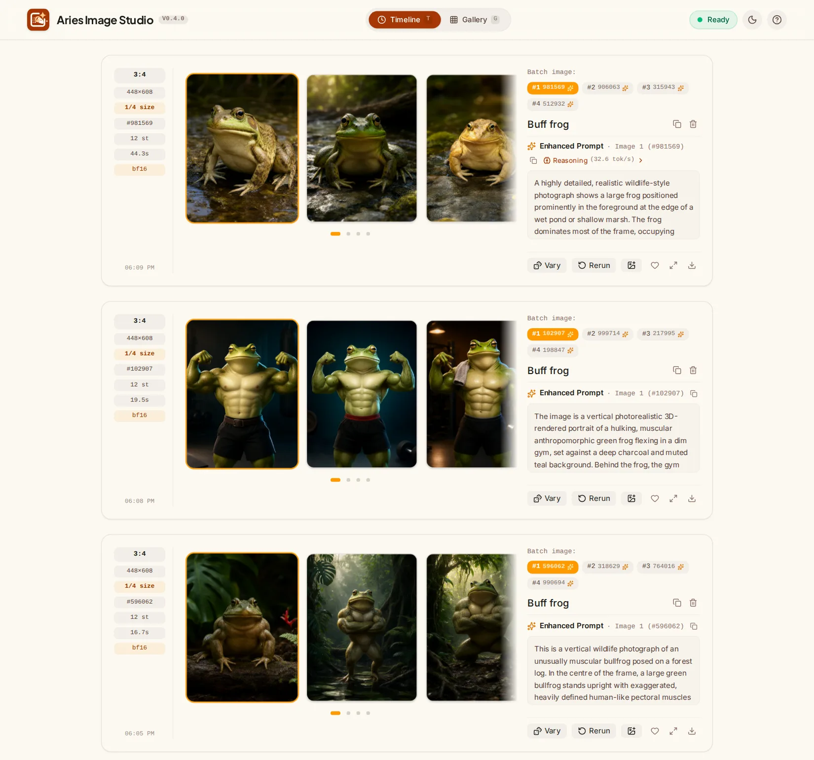

# Cloud prompt enhancers

Status: **shipped in 0.5.0; Claude Sonnet 5.5 and Gemini 3.5 Flash-Lite tried live** (§5). Builds on the enhance
stage ([ARCHITECTURE_V3.md](ARCHITECTURE_V3.md) §3.1) and the image-aware enhancer
([ENHANCER_I2I.md](ENHANCER_I2I.md)).

## 1. Why

The built-in enhancer is the slowest part of an Enhance job: it writes 3,000–4,000 tokens of
reasoning and reply at ~31 tok/s, so 100–135 s per image (ENHANCER_I2I.md §2), on a card that
could be drawing meanwhile. For a Draft or ¼-size preview that is most of the job. A hosted
model rewrites the same prompt in seconds without a card, and a different model gives
different rewrites, which helps when you want variations to choose from.

The built-in enhancer stays the default, and it is the only one that works offline.

## 2. What it is

- **Off by default.** `ARIES_CLOUD_ENHANCERS=on` on Studio switches it on; then each
  model of a provider whose key is set is offered. Keys live only in Studio's environment, and are
  never sent to the browser or written to logs.
- **The prompt and any reference images go to the provider, and its terms apply.** Free
  tiers may use what they receive to improve their models.
- **Enhancers: one per model**, named by its model id, each with its own limits:

  | Enhancer (model id) | Provider | Key | Limits kept (a minute) |
  |---|---|---|---|
  | `claude-sonnet-5-5` (Claude Sonnet 5.5) | Anthropic Messages API | `ANTHROPIC_API_KEY` | none by default |
  | `gemini-3.5-flash-lite` (Gemini 3.5 Flash-Lite) | Gemini API | `GEMINI_API_KEY` | 15 requests, 250K tokens (free tier; 500 a day) |

  `ARIES_GEMINI_MODELS` chooses the Gemini models and their limits.

- **Per send, in the composer.** With Enhance on, a picker next to it offers Built-in and
  each cloud enhancer. The choice is saved with the other preferences. Rerun and Vary
  bring back the image's enhancer.
- **A job names it:** `POST /api/jobs` takes `"enhancer": "<model id>"` (unset, or
  `builtin`: the agents' enhancer). An enhancer Studio does not offer is refused at
  submit (422). `/api/capabilities` lists the offered ones in `cloud_enhancers`
  (`id`, `provider`, `label`, `model`, `max_references`).

## 3. How it runs

**In Studio, as an ordinary enhance task.** The scheduler gives a queued enhance whose
job names a cloud enhancer to the pseudo-agent `cloud`, with the model id as its executor,
and Studio sends the request itself (`studio/src/cloud.rs`). Nothing changes for agents,
workers or the protocol; no card is used.

- **Same request as the built-in enhancer.** The system prompt is the project's
  rewriting prompt (`backend/aries_worker/stages/system_prompt.txt`, compiled into Studio);
  `ARIES_CLOUD_ENHANCER_PROMPT_FILE` replaces it, e.g. with the copy in the PE-T2I model
  directory. The user message is the prompt plus `Aspect ratio: …`, as the worker gets it.
- **Reference images:** sent as JPEG, longest side at most 1024 px, in prompt order. The
  system prompt then gets a short section on edits: write an instruction (what changes,
  then everything that stays), call the images "image 1", "image 2", …, and answer with
  `wh_ratio` or `ratio_follow`. Every model takes up to 10 images, the model's limit;
  encode and denoise still cap how many a job may carry.
- **Same result:** the reply's JSON (`rewritten_prompt`, then `wh_ratio` or
  `ratio_follow`) becomes the job's enhanced prompt, as from `enhanced.json`. The Gemini
  models' reasoning (thought parts, asked for with `includeThoughts`;
  `ARIES_GEMINI_THINKING=high`) is kept like the built-in enhancer's. Anthropic's system prompt is marked for prompt caching.
- **Token limit:** the job's enhancer token limit when set, else 8192.
- **Provenance:** agent `cloud`, executor the model id, backend kind
  `anthropic` / `gemini`, the model id, and timings (`enhance_s`, prompt and generated
  tokens, thought tokens, `rate_wait_s` when it had to wait). The viewer's time
  breakdown names the model; the PNG's provenance carries it.
- **Progress:** sub-stage `waiting` while held back by a rate limit ("waiting for the
  enhancer"), then `rewriting`. There are no token counts while it runs, so the bar is
  indeterminate.

## 4. Limits and failures

- **Rate limits.** Each enhancer has at most `ARIES_CLOUD_ENHANCE_CONCURRENCY` requests in
  flight (4), and Studio keeps a one-minute window of its requests and tokens: the Gemini
  models default to their free tiers' limits (table in §2, `ARIES_GEMINI_MODELS`);
  Claude has no limit set (`ARIES_ANTHROPIC_RPM` / `_TPM`). A request
  is counted at an estimate (text at ~4 characters a token, images as each provider counts
  them, a quarter of the reply limit), then at what the provider reports.
  The project's system prompt is ~2,400 tokens; Flash-Lite's 250K tokens a minute leave
  room, but only 15 requests a minute.
- **Daily quotas** are not counted by Studio: when one is used up, the provider says how
  long to wait; more than 2 minutes fails the attempt at once with its message.
- **Busy answers** (429, 503, 529, a dropped connection) are retried within the attempt,
  after `Retry-After`, Gemini's `retryDelay`, or 20 s, up to 4 times.
- **Anything else fails the attempt visibly**: a bad key (`cloud_auth`), a refusal
  (`cloud_refused`), a reply without the JSON (`bad_output`, also when it ran out of
  tokens), other HTTP errors (`cloud_error`). Like any stage it is tried once more, then
  the job fails with the reason. The failed card offers **Built-in** next to Retry:
  `POST /api/jobs/{id}/retry` with `{"enhancer": "builtin"}` (or another cloud id) retries
  with that enhancer. Studio never falls back to another enhancer by itself, so the
  enhancer recorded is always the one that wrote the prompt.
- **Studio restarts** requeue cloud enhances that were in flight (they ran in the old
  process).
- **An enhancer switched off** after a job was queued fails that job's enhance
  (`cloud_unavailable`); retry it with Built-in.

## 5. Side by side

"Buff frog", 4 images at ¼ size (448×608), Draft (12 steps), sent once per enhancer,
newest on top: **Built-in** (Qwen-Image-2.1-PE-T2I int4 on the cards), **Claude Sonnet
5.5**, **Gemini 3.5 Flash-Lite** (`thinkingLevel` high). Each image of a batch gets its
own rewrite.

| | Built-in | Claude Sonnet 5.5 | Gemini 3.5 Flash-Lite |
|---|---|---|---|
| Rewrite, each | 31–37 s (+ 9.5 s load), on a card | 12–20 s | 8–10 s |
| Tokens out, each | ~1,000 (~600 reasoning) at 33 tok/s | 1,300–2,400 at ~120 tok/s | 1,500–1,650 (1,150–1,350 reasoning) at 150–200 tok/s |
| Prompt tokens | 2,450 | 3,384 | 2,421 |
| Rewritten prompt | 2,100–2,350 characters | 2,500–2,950 | 1,300–2,000 |
| Send to last image | 122 s | 51 s | 53 s |
| What it made of "buff" | a big, bulky, wild frog: no muscles | a bodybuilder frog in shorts, in a gym, 3D-render look | a muscular bullfrog in a jungle, photographic |

- **The cloud enhancers roughly halve a draft batch** here, and leave both cards to
  encode and draw. With the built-in enhancer the cards spend most of the batch
  rewriting (two at a time, then the second two), even for a two-word prompt.
- **They read the prompt differently.** The built-in rewriter kept to a wildlife photo
  and lost "buff"; Sonnet took it literally and furthest; Flash-Lite stayed closest to a
  photograph while keeping the muscles. Rewrites vary a lot between enhancers, much
  less within one batch.
- Claude and Flash-Lite pick up the system prompt's British spelling ("centre",
  "colour").

## 6. Settings

Studio environment (`deploy/studio/.env`); BUILD_AND_RUN.md has the full table.

| Variable | Default | |
|---|---|---|
| `ARIES_CLOUD_ENHANCERS` | `off` | `on` offers the models below whose provider has a key |
| `ANTHROPIC_API_KEY` | unset | Offers Claude |
| `ARIES_ANTHROPIC_MODEL` | `claude-sonnet-5-5` | |
| `GEMINI_API_KEY` | unset | Offers the Gemini models below |
| `ARIES_GEMINI_MODELS` | `gemini-3.5-flash-lite:15:250000` | Each `model:rpm:tpm`: the window Studio keeps (the free tiers' limits; `0` or left out: none) |
| `ARIES_GEMINI_THINKING` | `high` | The Gemini models' `thinkingLevel`; `minimal` is faster, without reasoning |
| `ARIES_ANTHROPIC_RPM` / `ARIES_ANTHROPIC_TPM` | `0` / `0` | `0`: no window kept |
| `ARIES_CLOUD_ENHANCE_CONCURRENCY` | `4` | Requests in flight per enhancer |
| `ARIES_CLOUD_ENHANCER_PROMPT_FILE` | unset | Replaces the packaged rewriting prompt |
| `ARIES_ANTHROPIC_BASE_URL` / `ARIES_GEMINI_BASE_URL` | the public APIs | For a proxy, or tests |

## 7. Open

- **Thought parts.** The first live Flash-Lite runs reported ~1,200 thought tokens but
  kept no reasoning: the request did not ask for it. It now sets `includeThoughts`;
  to check that the reasoning shows up.
- **Edits.** Only text-to-image prompts compared so far; the same reference-image
  edits through every enhancer would show whether the edit section of the system
  prompt needs work.
