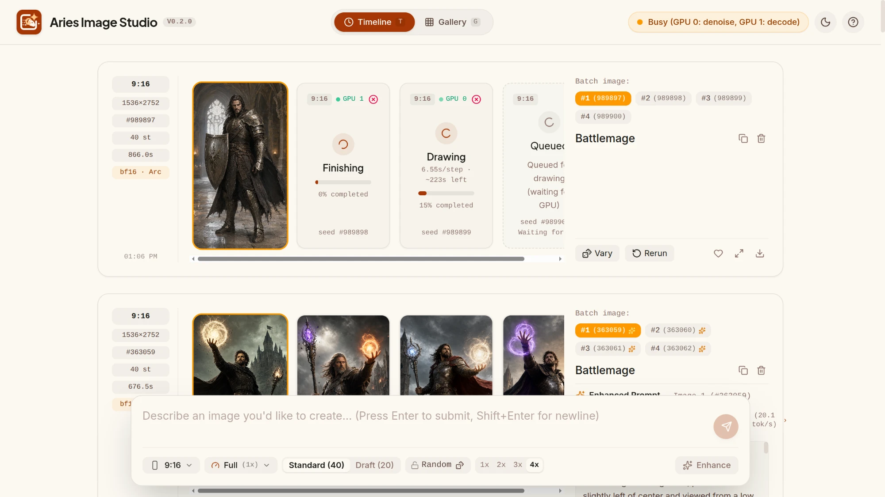
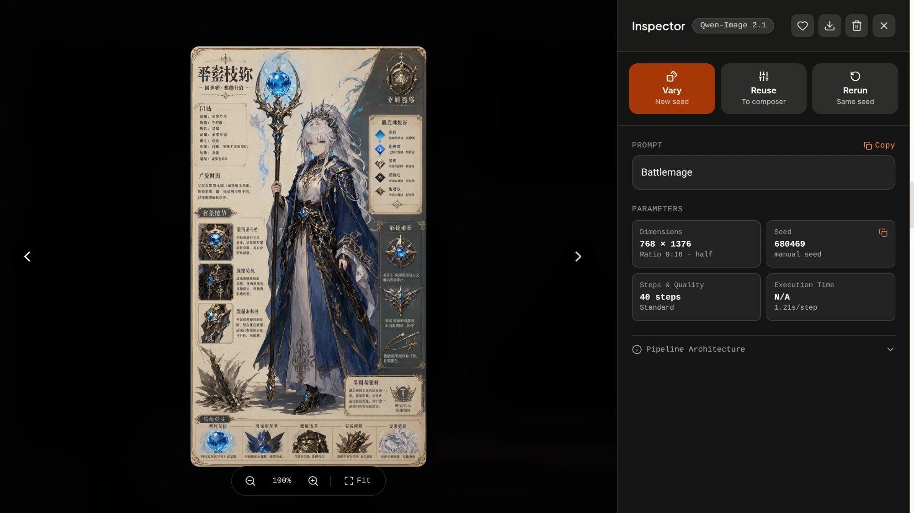

# Aries Image Studio 0.2.0

First public release. Aries Image Studio is a quiet, image-first web app for generating
images with [Qwen-Image-2.1](https://huggingface.co/Qwen/Qwen-Image-2.1) on a home
server with two Intel Arc Pro B60 GPUs: type a prompt, get pictures. Single user, LAN
only.

## Highlights

### Two GPUs, one pipeline

Generation runs as four stages — **enhance** (optional) → **encode** → **denoise** →
**decode** — each in its own worker process with one model on one card. A scheduler
hands each free card to the stage whose oldest job has waited longest. With a backlog
both cards denoise in parallel (roughly double throughput); with a trickle one card
stays on denoise while the other cycles the short stages.

### Prompt enhancement

Turn on **Enhance** and the official Qwen-Image-2.1-PE-T2I rewriter turns a short
prompt ("Battlemage") into a detailed scene description before drawing. The tile shows
the rewriter's sub-stages live (reading prompt → thinking → rewriting) with tokens per
second, and the result keeps both prompts plus the rewriter's reasoning. *Rerun with
this* reuses the enhanced prompt without enhancing again.

### Built to survive GPU faults

- Intermediate results (embeddings, latent, PNG) are written to disk atomically, so a
  crash costs at most the stage in flight.
- A failed stage is retried once, then the job fails with the stage and crash class
  (`python_error`, `oom_kill`, `wedged`) — no crash loops.
- An OOM kill raises the host RAM floor required for untiled decode; a card that
  faults leaves rotation while the other keeps working; a worker that cannot start is
  retried with exponential backoff.
- Workers exit when idle: on this stack, process exit is the only reliable way to give
  back VRAM, host RAM and driver overflow.

### The app

- **Timeline**: a turn per submission with 1–4 images, live progress per stage and
  per GPU, cancel and retry.
- **Composer**: 7 aspect ratios at ~2K, ½ and ¼ size presets, count, random or locked
  seed, Standard / Draft quality, Enhance.
- **Gallery** with favorites, aspect filters and search.
- **Inspector**: zoom, vary, reuse settings, rerun with the same seed, download.

  

- **Status panel**: each GPU's state, current stage and VRAM (including spill into host
  RAM), queue depth per stage, host RAM, and recent worker runs with why they exited.
- Keyboard shortcuts, light and dark themes, phone layout.
- Prometheus metrics at `/metrics`.

## Getting started

Requires Linux with the `xe` driver, Docker, two 24 GB Intel Arc cards (tested on
Arc Pro B60) and the model weights on local disk. See the
[README](../../README.md#quick-start) for the quick start and
[docs/HARDWARE.md](../HARDWARE.md) for host setup.

## Known issues

These are visible in this release and planned for the next one:

- **Finishing shows 0%.** Decode has no steps, so its progress bar sits at 0% until
  the image appears.
- **"Execution Time" includes queue wait.** It is measured from submission, so later
  images of a batch show the time spent waiting for a GPU; images created before
  0.2.0 show N/A.
- **Hardware details in the Inspector are fixed text** ("2× Intel Arc Pro B60", PCI
  addresses, "Untiled VAE Decode") rather than read from the job.
- **Status panel:** "Peak" VRAM is the maximum since the manager started, and a small
  baseline driver allocation shows as a host RAM spill warning even when idle.
- No authentication: the browser talks to the manager directly — keep it on a trusted
  network.
- History lives in the browser (localStorage and IndexedDB), per browser.

## What's next

A Rust **Studio** server — always on, owning history, gallery and images in SQLite and
accepting jobs while the GPU host sleeps — replaces browser storage in the next major
version. Alert rules, a Grafana dashboard and edit-with-references are on the list too.

Full change list: [CHANGELOG.md](../../CHANGELOG.md).
